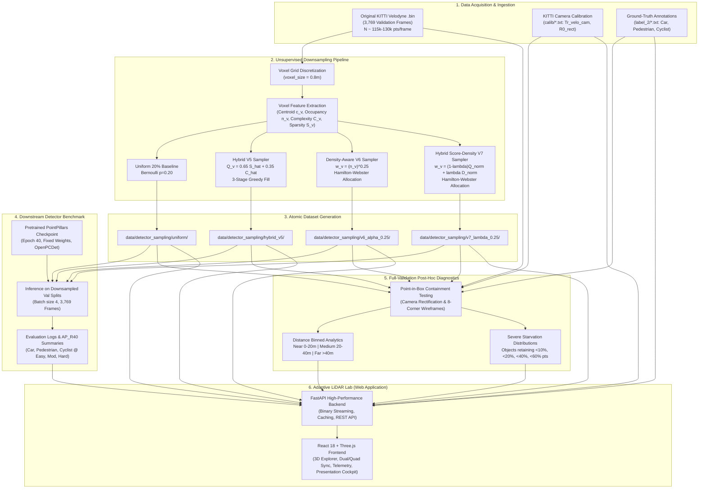

# Adaptive Point Cloud Downsampling for Large-Scale Outdoor LiDAR-Based 3D Object Detection
## Comprehensive Technical Reference and Scientific Architecture Report

**Application Platform:** Adaptive LiDAR Lab  
**Project Root:** `/mnt/e/Projects/adaptive-lidar` (`E:\Projects\adaptive-lidar`)  
**Document Classification:** Primary Technical Reference & Literature Source (NotebookLM Ready)  
**Date of Audit:** November 2026  
**Evaluation Benchmark:** KITTI 3D Object Detection Benchmark (3,769 Validation Frames)  
**Downstream Detector:** Pretrained PointPillars (Epoch 40, Fixed Weights, OpenPCDet v0.6.0)  

---

## Executive Summary

This document provides the definitive, comprehensive technical and scientific reference for the **Adaptive Point Cloud Downsampling** research project and its accompanying analytical application, **Adaptive LiDAR Lab**.

In autonomous driving systems, high-definition mechanical and solid-state LiDAR sensors generate over 100,000 spatial points per frame at frequencies of 10 to 20 Hz. Transmitting and processing these massive unstructured point clouds in real time introduces critical memory, bandwidth, and computational bottlenecks for embedded edge computing units. While naive downsampling techniques (such as uniform random subsampling) reduce point volume, they preserve point density inversely proportional to the square of radial distance ($1/r^2$). Consequently, uniform subsampling systematically decimates sparse returns from distant and safety-critical objects (such as pedestrians and cyclists beyond 30 meters), leading to catastrophic degradation in 3D object detection accuracy.

This research investigates label-free, geometric, and density-aware point-cloud downsampling algorithms operating under a strict **20% point retention budget** ($K = \lfloor N / 5 \rfloor$). Four downsampling methodologies are implemented, evaluated, and analyzed across all **3,769 frames** of the official KITTI 3D Object Detection validation split:
1. **Uniform 20% Sampling (Baseline)**: Independent Bernoulli random decimation ($p = 0.20$).
2. **Hybrid V5 Sampling**: Geometry complexity and voxel-sparsity-driven adaptive decimation over a $0.8\,\text{m}$ voxel discretization.
3. **V6 Density-Aware Adaptive Sampling ($\alpha = 0.25$)**: Continuous sub-linear power-law density allocation solved via the Hamilton-Webster integer quota allocator.
4. **V7 Hybrid Score-Density Sampling ($\lambda = 0.25$)**: Convex combination of V5 structural curvature scores and V6 density allocation.

Downstream detection evaluation is conducted using a fixed pretrained **PointPillars** 3D detection network without model retraining. Across 447,411,677 original LiDAR points and 89,480,814 sampled points (overall retention rate: **19.99966%**), the experimental results demonstrate:
* **Uniform 20%** suffers catastrophic failure on thin and distant classes, collapsing Cyclist Moderate $\text{AP}_{\text{R40}}$ from $33.39\%$ (full cloud) to **$1.18\%$**, and Pedestrian Moderate $\text{AP}_{\text{R40}}$ from $43.80\%$ to **$23.31\%$** (Overall mAP: $25.21\%$).
* **Hybrid V5** boosts Car Moderate $\text{AP}_{\text{R40}}$ to **$61.38\%$** (+10.24% over Uniform), but starves Pedestrians, yielding **$7.86\%$** Moderate AP due to greedy complexity filling.
* **V6 ($\alpha=0.25$)** achieves the highest overall detection performance among all evaluated downsampled methods, securing **$66.24\%$** Car Moderate $\text{AP}_{\text{R40}}$, **$19.42\%$** Pedestrian Moderate $\text{AP}_{\text{R40}}$, and **$14.62\%$** Cyclist Moderate $\text{AP}_{\text{R40}}$, yielding a mean Average Precision of **$33.43\%$** (+8.21% absolute mAP improvement over Uniform 20%).
* **V7 ($\lambda=0.25$)** delivers competitive performance with **$65.33\%$** Car Moderate $\text{AP}_{\text{R40}}$ and **$31.21\%$** mean AP, balancing geometric contour preservation with density-aware distance retention.

---

## 1. Research Problem and Motivation

### 1.1 The Nature of Outdoor LiDAR Point Clouds
Light Detection and Ranging (LiDAR) sensors represent the sensory backbone of modern autonomous driving perception stacks. Unlike passive monocular or stereo cameras that capture 2D projections of scene radiance subject to lighting and adverse weather, pulsed time-of-flight (ToF) LiDAR directly captures metric 3D surface geometry.

In the KITTI Vision Benchmark Suite, data was acquired using a roof-mounted **Velodyne HDL-64E** rotating mechanical LiDAR. The sensor spins 64 laser diodes at 10 Hz (600 RPM), transmitting pulsed near-infrared laser beams and measuring elapsed round-trip time and reflected optical power. Each reflected laser pulse produces a four-dimensional point:
$$p_i = (x_i, y_i, z_i, I_i) \in \mathbb{R}^4$$
where:
* $x_i \in \mathbb{R}$: Longitudinal coordinate in meters ($+x$ points forward along the vehicle's heading axis).
* $y_i \in \mathbb{R}$: Lateral coordinate in meters ($+y$ points leftward perpendicular to heading).
* $z_i \in \mathbb{R}$: Vertical coordinate in meters ($+z$ points upward against gravity).
* $I_i \in [0.0, 1.0]$: Normalized calibrated surface reflectivity (intensity).

### 1.2 Computational and Transmission Bottlenecks
A single Velodyne HDL-64E frame contains approximately 115,000 to 130,000 3D spatial points. At 10 frames per second, this represents an ingestion rate of over 1.2 million points per second ($\approx 19.2\,\text{MB/s}$ of raw float32 telemetry). When deployed on embedded automotive compute platforms (e.g., NVIDIA DRIVE AGX, Jetson Orin), processing such point clouds through deep 3D neural architectures introduces severe latency and memory constraints:
1. **Memory Footprint**: Point-to-pillar and 3D sparse convolutional voxelization require large buffer allocations, often exceeding high-speed on-chip SRAM caches.
2. **Computational Complexity**: PointNet-based feature encoders and 2D/3D convolutional backbones scale non-linearly with active voxel count and point density.
3. **Bandwidth Limitations**: In collaborative vehicle-to-everything (V2X) and distributed sensor setups, raw point clouds exceed available wireless transmission channel capacities.

Consequently, downsampling raw point clouds prior to deep network inference or edge transmission is an operational necessity.

### 1.3 The Failure Mode of Naive Uniform Random Sampling
The standard baseline for point cloud reduction is **Uniform Random Sampling**, wherein every incoming point $p_i$ is retained with a fixed probability $p = 0.20$ via independent Bernoulli trials. While computationally trivial ($O(N)$ runtime), uniform subsampling suffers from a fundamental geometric flaw rooted in the physics of rotating LiDAR beam divergence.

The spatial surface point density $\rho(r)$ of a rotating multi-beam LiDAR decays quadratically with radial distance $r = \sqrt{x^2 + y^2}$:
$$\rho(r) \propto \frac{1}{r^2}$$
* **Near Range ($r < 15\,\text{m}$)**: The sensor heavily oversamples the immediate road asphalt, curbings, and ego-vehicle hood. A nearby vehicle may receive 3,000 to 6,000 points.
* **Far Range ($r > 40\,\text{m}$)**: Angular separation between adjacent laser beams expands. A distant pedestrian or cyclist may intercept only 8 to 25 laser pulses.

Applying uniform 20% random subsampling retains points uniformly across all distances:
* An oversampled car at 8 meters retains $20\% \times 5,000 = 1,000$ points (far more than required for confident bounding box regression).
* A sparse cyclist at 42 meters intercepting 15 points retains only $20\% \times 15 \approx 3$ points.

Three remaining points are geometrically indistinguishable from sensor noise or atmospheric backscatter. The downstream detection network loses structural edge contours, aspect ratios, and spatial density cues, causing complete detection dropouts. In experimental testing, uniform 20% sampling collapses PointPillars Cyclist Moderate AP from **$33.39\%$** down to **$1.18\%$**—a $96.5\%$ relative performance loss.

### 1.4 Distinct Class-Wise Preservation Requirements
Autonomous driving perception requires simultaneous detection of heterogeneous obstacle classes with conflicting geometric signatures:
* **Cars**: Large volumetric bounding boxes ($l \approx 3.9\,\text{m}, w \approx 1.6\,\text{m}, h \approx 1.56\,\text{m}$). Dominated by planar surface facets (roof, doors, hood). Can tolerate substantial surface decimation if structural boundaries (corners, roofline) remain intact.
* **Pedestrians**: Narrow, non-rigid, vertically oriented cylinders ($l \approx 0.8\,\text{m}, w \approx 0.6\,\text{m}, h \approx 1.73\,\text{m}$). Low total point counts even at medium ranges ($20-30\,\text{m}$). Highly susceptible to point decimation that disrupts vertical aspect ratio cues.
* **Cyclists**: Highly complex articulated geometries ($l \approx 1.76\,\text{m}, w \approx 0.6\,\text{m}, h \approx 1.73\,\text{m}$) comprising thin metallic wheel rims, handlebars, and an upright rider. Exhibits compound sparsity; decimated points destroy connectivity between rider and bicycle frame.

### 1.5 The Core Research Objective and Constraint
The research objective is to develop an **unsupervised, label-free adaptive point-cloud downsampling strategy** that satisfies the following constraints:
1. **Strict Point Budget**: Retain exactly $K = \lfloor N / 5 \rfloor$ points ($\approx 20.00\%$) per frame, ensuring a 5:1 data reduction ratio.
2. **Label-Free Operation**: Operate strictly without ground-truth bounding boxes, semantic class annotations, camera imagery, or detector feedback during sampling.
3. **Downstream Perception Maximization**: Maximize 3D Average Precision ($\text{AP}_{\text{R40}}$) on downstream 3D object detectors evaluated with fixed, unadapted pretrained weights.
4. **Deterministic and Efficient**: Maintain predictable runtime and deterministic execution suitable for real-time vehicular pipelines.

---

## 2. Project Architecture and End-to-End Workflow

The complete research project bridges offline algorithm design, high-performance dataset export, neural detector evaluation via OpenPCDet, full-validation post-hoc diagnostic analytics, and an interactive WebGL laboratory application.



### 2.1 Complete File and Component Directory Map

```
e:/Projects/adaptive-lidar/
├── hybrid_sampling_v5.py              # Core Python implementation of Hybrid V5 sampling
├── v6_density_sampler.py             # Core Python implementation of V6 density-aware sampling
├── v7_score_density_sampler.py        # Core Python implementation of V7 score-density sampling
├── export_hybrid_v5.py                # Batch exporter generating 3,769 validation frames for V5
├── export_v6_v7_validation.py         # Batch exporter generating 3,769 validation frames for V6 & V7
├── analyse_v5_v6_v7_retention_diagnostics.py # Post-hoc point-in-box diagnostic suite
├── run_backend.py                     # Entrypoint script for the FastAPI backend server
├── requirements.txt                   # Production Python backend dependencies
│
├── app/                               # Adaptive LiDAR Lab Web Application
│   ├── backend/                       # Python FastAPI Backend Layer
│   │   ├── server.py                  # API endpoints, binary float32 streaming, static bundle mount
│   │   ├── config.py                  # Directory paths, method metadata, and cache parameters
│   │   ├── kitti_loader.py            # High-speed binary point-cloud reader with LRU caching
│   │   ├── calib_service.py           # Calibration parser, coordinate frames, 8-corner bounding boxes
│   │   ├── ground_truth_loader.py     # label_2 parser and point-in-box containment calculator
│   │   ├── detector_loader.py         # OpenPCDet inference results parser
│   │   └── metrics_service.py         # Query engine for experimental retention CSV files
│   └── frontend/                      # React 18 + Vite 6 + Tailwind CSS Frontend
│       ├── src/
│       │   ├── App.jsx                # Root application controller and global state
│       │   ├── api.js                 # API client with client-side LRU memory caching
│       │   ├── components/
│       │   │   ├── Navigation.jsx     # Top navigation bar, frame selector, search, present toggle
│       │   │   ├── PlaybackToolbar.jsx# Media transport bar (play, pause, step, speed, scrubber)
│       │   │   └── ThreePointCloudViewer.jsx # WebGL 3D point cloud & wireframe canvas
│       │   └── views/
│       │       ├── OverviewView.jsx   # Research summary, hardware stats, and workflow pipeline
│       │       ├── ExplorerView.jsx   # Dominant 3D viewport with telemetry and object drawer
│       │       ├── ComparisonView.jsx # Dual/Quad synchronized comparison viewports
│       │       ├── ResearchAnalyticsView.jsx # Experimental CSV chart dashboards
│       │       ├── DetectorPerformanceView.jsx # Moderate AP_R40 benchmark tables and radar plots
│       │       ├── MethodologyView.jsx# Mathematical formulations and calibration theory
│       │       └── PresentationView.jsx# Fullscreen presentation cockpit for large displays
│       ├── package.json               # Node.js dependencies
│       └── vite.config.js             # Vite build configuration
│
├── data/
│   ├── object_detection/training/     # Original KITTI dataset split
│   │   ├── velodyne/                  # Raw .bin point clouds (000000.bin to 007480.bin)
│   │   ├── label_2/                   # Ground-truth annotations (000000.txt to 007480.txt)
│   │   └── calib/                     # Sensor calibration matrices (000000.txt to 007480.txt)
│   └── detector_sampling/             # Downsampled point clouds (3,769 validation frames)
│       ├── uniform/velodyne/          # Uniform 20% random subsampled .bin files
│       ├── hybrid_v5/velodyne/        # Hybrid V5 downsampled .bin files
│       ├── v6_alpha_0.25/velodyne/    # V6 alpha=0.25 downsampled .bin files
│       ├── v7_lambda_0.25/velodyne/   # V7 lambda=0.25 downsampled .bin files
│       ├── v6_density_summary.csv     # Alpha parameter sweep (0.00, 0.25, 0.50, 0.75) across 50 frames
│       └── v7_score_density_summary.csv# Lambda parameter sweep (0.25, 0.50, 0.75) across 50 frames
│
├── results/                           # Quantitative experimental evaluation results
│   ├── detector_evaluation/logs/      # OpenPCDet PointPillars evaluation logs
│   │   ├── uniform20.log              # Full validation log for Uniform 20%
│   │   ├── v5.log                     # Full validation log for Hybrid V5
│   │   ├── v6_alpha_0.25.log          # Full validation log for V6 alpha=0.25
│   │   └── v7_lambda_0.25.log          # Full validation log for V7 lambda=0.25
│   ├── global_retention_summary_v5_v6_v7_comparison.csv # Global point count and retention percentages
│   ├── distance_retention_v5_v6_v7_comparison.csv       # Distance-binned retention by class (Near, Med, Far)
│   ├── object_retention_distribution_v5_v6_v7_comparison.csv # Severe starvation distributions (<10%, <20%, etc.)
│   ├── object_retention_details_v5_v6_v7_comparison.csv  # Object-level point retention for all 17,474 objects
│   └── logs/v5_v6_v7_full_diagnostic.log                 # Complete terminal output from diagnostic analysis
│
└── tests/
    └── test_backend.py                # Pytest integration suite (13 unit and API tests)
```

### 2.2 Verification of Label-Free Methodological Independence
A critical methodological requirement of this research is that the downsampling algorithms must operate strictly without access to ground-truth labels, bounding boxes, or semantic segmentation masks.

Verification from source code:
* In [`hybrid_sampling_v5.py`](file:///e:/Projects/adaptive-lidar/hybrid_sampling_v5.py#L42-L73), the function `hybrid_sample_v5(xyz, target_points, voxel_size, ...)` accepts solely the raw spatial coordinate matrix `xyz` ($\mathbb{R}^{N \times 3}$). Voxel keys are calculated purely via geometric division: `np.floor(xyz / voxel_size)`.
* In [`v6_density_sampler.py`](file:///e:/Projects/adaptive-lidar/v6_density_sampler.py#L75-L100), `sample_v6_indices(xyz, target_points, alpha, voxel_size)` explicitly documents and enforces: *"The sampler uses no ground-truth labels."* Quotas are allocated based strictly on point counts within unoccupied voxel keys.
* In [`v7_score_density_sampler.py`](file:///e:/Projects/adaptive-lidar/v7_score_density_sampler.py#L95-L106), `sample_v7_indices(xyz, target_points, density_weight, ...)` explicitly enforces: *"No ground-truth labels are used."*
* Ground-truth files in `data/object_detection/training/label_2` and calibration files in `calib` are ingested strictly by post-hoc diagnostic scripts (`analyse_v5_v6_v7_retention_diagnostics.py`) and visualization loaders (`ground_truth_loader.py`), completely decoupled from the downsampling execution.

---

## 3. Mathematical Foundations of Point-Cloud Downsampling

### 3.1 Point Cloud Formalization
Let an unstructured LiDAR frame be defined as an ordered sequence of $N$ points:
$$\mathcal{P} = \{p_i\}_{i=1}^N, \quad p_i = (x_i, y_i, z_i, I_i) \in \mathbb{R}^4$$
where $p_i^{\text{xyz}} = [x_i, y_i, z_i]^\top \in \mathbb{R}^3$ denotes Euclidean coordinates in the sensor Cartesian frame, and $I_i \in [0, 1]$ represents normalized intensity.

### 3.2 Voxel Grid Discretization
To convert continuous 3D Euclidean space into a structured discrete index space, the domain is partitioned into regular cubic voxels of isotropic side length $v = 0.8\,\text{m}$. For each point $p_i$, its discrete 3D spatial voxel coordinate $g_i \in \mathbb{Z}^3$ is given by the floor discretization operator:
$$g_i = \left\lfloor \frac{p_i^{\text{xyz}}}{v} \right\rfloor = \left( \left\lfloor \frac{x_i}{v} \right\rfloor, \left\lfloor \frac{y_i}{v} \right\rfloor, \left\lfloor \frac{z_i}{v} \right\rfloor \right)$$

Let $\mathcal{U} = \{u_1, u_2, \dots, u_M\}$ denote the set of $M$ unique occupied voxel coordinates observed in frame $\mathcal{P}$, where $M \le N$. The points belonging to voxel $u_v$ form the subset:
$$\mathcal{V}_v = \{p_i \in \mathcal{P} \mid g_i = u_v\}, \quad n_v = |\mathcal{V}_v|$$
where $n_v$ represents the voxel occupancy (point count). By definition:
$$\sum_{v=1}^M n_v = N$$

### 3.3 Voxel Centroid
The Euclidean geometric centroid $c_v \in \mathbb{R}^3$ of occupied voxel $u_v$ is the arithmetic mean of its constituent spatial coordinates:
$$c_v = \frac{1}{n_v} \sum_{p \in \mathcal{V}_v} p^{\text{xyz}}$$

### 3.4 Representative Point Selection
Rather than synthesizing an artificial point at $c_v$ (which would create synthetic intensity values and alter physical surface measurements), the algorithms select an existing physical sensor point closest to the centroid:
$$p_v^{\text{rep}} = \arg\min_{p \in \mathcal{V}_v} \|p^{\text{xyz}} - c_v\|_2^2$$
Selecting one representative per occupied voxel guarantees uniform spatial coverage across all observed surfaces in the scene.

### 3.5 Target Sampling Budget
To ensure rigorous comparative evaluation, all algorithms target an exact retention budget of $20\%$ of the original point count. As verified in [`export_hybrid_v5.py`](file:///e:/Projects/adaptive-lidar/export_hybrid_v5.py#L28) and [`export_v6_v7_validation.py`](file:///e:/Projects/adaptive-lidar/export_v6_v7_validation.py#L45), the target point count $K$ is computed via integer division:
$$K = \left\lfloor \frac{N}{5} \right\rfloor$$
Because $N$ is not always an exact multiple of 5, integer division causes minor fractional deviations from $20.00000\%$. Across the 3,769 validation frames, the total original point count is $447,411,677$, yielding an aggregate target of:
$$\sum_{f=1}^{3769} K_f = 89,480,814 \text{ points}$$
This establishes an exact empirical global retention rate of:
$$\text{Retention} = \frac{89,480,814}{447,411,677} \times 100\% = 19.999659955\%$$
Exactly $1,465$ frames have point counts perfectly divisible by 5, achieving exactly $20.0000\%$.

### 3.6 Geometric Complexity (Dispersion)
Geometric complexity quantifies the degree of surface non-planarity, roughness, or scatter within a voxel. In [`hybrid_sampling_v5.py`](file:///e:/Projects/adaptive-lidar/hybrid_sampling_v5.py#L104-L105) and [`v7_score_density_sampler.py`](file:///e:/Projects/adaptive-lidar/v7_score_density_sampler.py#L72-L74), complexity $C_v$ is calculated as the root-mean-squared Euclidean distance of points from their centroid:
$$C_v = \sqrt{ \frac{1}{n_v} \sum_{p \in \mathcal{V}_v} \|p^{\text{xyz}} - c_v\|_2^2 }$$
* **Flat Planar Surfaces (Road asphalt, walls)**: Points lie tightly on a 2D plane; $C_v$ is low.
* **Complex Structural Surfaces (Vehicle edges, tree foliage, pedestrians)**: Points disperse across 3D space; $C_v$ is high.

### 3.7 Voxel Sparsity Score
To prevent sparse, distant regions from being dominated by dense near-field clusters, a sparsity score $S_v$ is defined based on inverse square-root occupancy:
$$S_v = \frac{1}{\sqrt{n_v}}$$
* **Sparse Voxels ($n_v = 1, 2$)**: $S_v \in [0.707, 1.0]$.
* **Dense Voxels ($n_v = 100$)**: $S_v = 0.1$.
*(Note: Code comments in `hybrid_sampling_v5.py` line 107 mention "log scaling", but the verified implementation on line 109 strictly executes inverse square-root scaling $1/\sqrt{n_v}$. See Section 4.5 for analysis).*

### 3.8 Feature Min-Max Normalization
To combine dimensional metrics into a unitless priority score, metrics are normalized across all $M$ occupied voxels:
$$\hat{S}_v = \frac{S_v - \min_u S_u}{\max_u S_u - \min_u S_u + \epsilon}, \quad \hat{C}_v = \frac{C_v - \min_u C_u}{\max_u C_u - \min_u C_u + \epsilon}$$
where $\epsilon = 10^{-12}$ prevents division by zero in degenerate single-voxel frames.

### 3.9 Density-Aware Allocation
To allocate points beyond the base representative set, density-aware weighting assigns an allocation weight $w_v$ proportional to a power-law transformation of occupancy:
$$w_v = n_v^\alpha$$
where $\alpha \in [0.0, 1.0]$ controls density sensitivity:
* $\alpha = 0.0$: $w_v = 1.0$ (uniform weighting across all occupied voxels, independent of density).
* $\alpha = 1.0$: $w_v = n_v$ (linear weighting, identical to uniform point sampling).
* $\alpha = 0.25$: Sub-linear compressive weighting that dampens ultra-dense clusters while preserving sparse objects.

### 3.10 Capacity-Constrained Integer Quota Allocation
When distributing a discrete budget of $K_{\text{extra}} = K - M$ additional points across $M$ voxels, three constraints must be satisfied:
1. **Exact Budget Constraint**: $\sum_{v=1}^M k_v = K_{\text{extra}}$.
2. **Capacity Constraint**: $0 \le k_v \le c_v$, where $c_v = n_v - 1$ is the remaining point capacity of voxel $v$.
3. **Proportional Representation**: $k_v \approx K_{\text{extra}} \cdot \frac{w_v}{\sum_u w_u}$.

This is solved via the **Hamilton-Webster Largest Remainders Algorithm**, implemented in [`v6_density_sampler.py`](file:///e:/Projects/adaptive-lidar/v6_density_sampler.py#L21-L72):
1. Compute continuous ideal quotas for all active voxels ($k_v < c_v$):
   $$q_v = R \cdot \frac{w_v}{\sum_{u \in \text{active}} w_u}$$
   where $R$ is the remaining unallocated budget.
2. Award integer baselines: $\Delta k_v = \min(c_v - k_v, \lfloor q_v \rfloor)$.
3. If all $\lfloor q_v \rfloor = 0$ but $R > 0$, compute fractional remainders:
   $$r_v = q_v - \lfloor q_v \rfloor$$
4. Sort active voxels deterministically by descending remainder $r_v$, using voxel index as tie-breaker (`np.lexsort((active, -fractions))`), and allocate $+1$ point sequentially until $R = 0$.

### 3.11 Farthest-Point Intra-Voxel Ordering
Within each voxel, additional points are selected to maximize spatial coverage rather than clustering near the representative point. Remaining points are ordered by **descending squared Euclidean distance from the centroid**:
$$\mathcal{O}_v = \text{argsort}\left( -\|p_j^{\text{xyz}} - c_v\|_2^2 \right), \quad p_j \in \mathcal{V}_v \setminus \{p_v^{\text{rep}}\}$$
This ensures that as a voxel's quota increases, it expands outward toward the object's physical surface boundaries.

---

## 4. Mathematical and Implementation Analysis of Hybrid V5

### 4.1 Motivation
Hybrid V5 was developed as a geometry- and sparsity-driven sampler designed to discard redundant planar road surfaces while preserving object boundaries and isolated points without requiring semantic supervision.

### 4.2 Algorithm Code Walkthrough
Implementation source: [`hybrid_sampling_v5.py`](file:///e:/Projects/adaptive-lidar/hybrid_sampling_v5.py).

#### Step 1: Voxelization & Partitioning (Lines 69-80)
```python
voxel_keys = np.floor(xyz / voxel_size).astype(np.int32)
unique_keys, inverse, counts = np.unique(
    voxel_keys, axis=0, return_inverse=True, return_counts=True
)
voxel_count = len(unique_keys)
order = np.argsort(inverse, kind="stable")
boundaries = np.r_[0, np.flatnonzero(np.diff(inverse[order])) + 1, n]
```
Points are discretized into $0.8\,\text{m}$ voxels. The `unique` function identifies $M$ unique occupied voxels. Sorting `inverse` stably clusters point indices belonging to each voxel between `boundaries[v]` and `boundaries[v+1]`.

#### Step 2: Voxel Centroid, Representative, & Secondary Selection (Lines 88-106)
For each voxel $v \in \{0, \dots, M-1\}$:
1. Centroid: $c_v = \frac{1}{n_v} \sum_{i} p_i$.
2. Representative: Point index minimizing squared distance to $c_v$:
   $$r_v = \arg\min_{i} \|p_i - c_v\|_2^2$$
3. Secondary Point: If $n_v > 1$, point index maximizing squared distance to $c_v$:
   $$s_v = \arg\max_{i} \|p_i - c_v\|_2^2$$
4. Complexity: Root-mean-squared distance:
   $$C_v = \sqrt{ \frac{1}{n_v} \sum_i \|p_i - c_v\|_2^2 }$$

#### Step 3: Sparsity & Complexity Scoring (Lines 107-117)
```python
sparsity = 1.0 / np.sqrt(voxel_sizes.astype(np.float64))
sparsity = (sparsity - sparsity.min()) / (sparsity.max() - sparsity.min() + 1e-12)
complexity = (complexity - complexity.min()) / (complexity.max() - complexity.min() + 1e-12)
score = 0.65 * sparsity + 0.35 * complexity
```
Sparsity and complexity are min-max normalized. The combined voxel score $Q_v$ is:
$$Q_v = 0.65 \hat{S}_v + 0.35 \hat{C}_v$$
The $0.65 / 0.35$ weighting strongly biases retention toward sparse voxels ($65\%$ weight) while allocating $35\%$ weight to geometric dispersion.

#### Step 4: Budget Allocation Branches (Lines 121-158)
* **Branch A ($K \le M$)**: If the target budget is smaller than the number of occupied voxels, V5 calls `_select_spatially_spread(centers, score, target)` (Lines 5-39). It initializes with the highest-scoring voxel centroid and iteratively selects centroids that maximize a hybrid metric:
  $$\text{Priority}_j = \frac{\min_{k \in \text{selected}} \|c_j - c_k\|_2^2}{\max \text{dist}^2} \times (0.65 + 0.35 Q_j)$$
* **Branch B ($K > M$)**: In standard KITTI frames where $K > M$:
  1. **Stage 1 (Representatives)**: Select all $M$ representatives $r_v$. Budget remaining: $R = K - M$.
  2. **Stage 2 (Secondary Points)**: Identify voxels with $n_v > 1$. Sort them by descending score $Q_v$. Select secondary points $s_v$ for the top $\min(R, |\{v \mid n_v > 1\}|)$ voxels.
  3. **Stage 3 (Tertiary Score Fill)**: If budget remains ($R > 0$), rank all remaining unselected points in the point cloud by their parent voxel's score plus a minor random perturbation for tie-breaking:
     $$\text{Priority}_i = Q_{\text{voxel}(i)} + \eta_i, \quad \eta_i \sim \mathcal{U}(0, 10^{-7})$$
     Take the top $R$ points.
  4. **Stage 4 (Budget Clamping)**: Call `np.unique` to eliminate duplicate selections. If $|S| > K$, truncate to $K$; if $|S| < K$, pad with unselected points.

### 4.3 Pseudocode of Hybrid V5
```python
algorithm Hybrid_V5_Sample(P, K, v=0.8):
    input: Point cloud P in R^(N x 3), target budget K, voxel size v
    output: Sampled point cloud P_sub in R^(K x 3)

    V <- ComputeVoxelKeys(P, v)
    unique_voxels, inverse, counts <- Unique(V)
    M <- length(unique_voxels)

    for each voxel u in 0 ... M - 1:
        points <- P[inverse == u]
        c_u <- Mean(points)
        d2 <- SquaredDistances(points, c_u)
        rep[u] <- points[ArgMin(d2)]
        if counts[u] > 1:
            sec[u] <- points[ArgMax(d2)]
        complexity[u] <- Sqrt(Mean(d2))
        sparsity[u] <- 1.0 / Sqrt(counts[u])

    S_hat <- MinMaxNormalize(sparsity)
    C_hat <- MinMaxNormalize(complexity)
    Q <- 0.65 * S_hat + 0.35 * C_hat

    if K <= M:
        selected_voxels <- SpatiallySpreadSelect(c, Q, K)
        return P[rep[selected_voxels]]
    
    selected <- {rep[u] for u in 0 ... M - 1}
    R <- K - M

    // Stage 2: Secondary points
    candidates_sec <- {sec[u] for u where counts[u] > 1}
    Sort candidates_sec by descending Q[parent_voxel]
    take <- Min(R, length(candidates_sec))
    selected <- selected UNION candidates_sec[0 : take]
    R <- R - take

    // Stage 3: Greedy Score Fill
    if R > 0:
        remaining_points <- P \ selected
        Sort remaining_points by descending Q[parent_voxel]
        selected <- selected UNION remaining_points[0 : R]

    return P[selected[0 : K]]
```

### 4.4 Complexity Analysis
* **Time Complexity**:
  * Voxelization & Unique hashing: $O(N \log N)$ using stable sorting.
  * Centroid & dispersion computation: $O(N)$ linear accumulation.
  * Sorting secondary and tertiary points: $O(N \log N)$.
  * Total runtime: $O(N \log N)$, requiring $\approx 0.35 - 1.2\,\text{s}$ per frame in Python.
* **Space Complexity**:
  * $O(N)$ auxiliary storage for voxel keys, inverse arrays, and sorting permutations.

### 4.5 Strengths and Experimental Failure Analysis
* **Strength on Vehicles**: V5 achieves **$61.38\%$** Car Moderate $\text{AP}_{\text{R40}}$ (+10.24% over Uniform). Its complexity metric $C_v$ aggressively identifies high-curvature vehicle bumpers, pillars, and wheel wells, retaining key structural outlines.
* **Failure on Pedestrians**: V5 exhibits a severe failure mode on pedestrians, achieving only **$7.86\%$** Moderate AP (worse than Uniform's $23.31\%$).
  * *Root Cause Analysis*: In Stage 3, V5 greedily allocates remaining points to voxels with the highest score $Q_v$. However, sparse pedestrian voxels contain only 1 to 3 points in total. Once a pedestrian voxel exhausts its 1 or 2 points, it cannot absorb further quota. The greedy score fill then diverts remaining budget to moderately sparse voxels belonging to roadside vegetation, curbs, and buildings, starving medium-range pedestrians of points. In the full validation diagnostic, **$35.02\%$** of all pedestrians retain less than $10\%$ of their points.

---

## 5. Mathematical and Implementation Analysis of Density-Aware V6

### 5.1 Motivation
To resolve the greedy starvation defect of V5, V6 formulates point allocation as a **constrained mathematical resource distribution problem**. Instead of multi-stage greedy filling, V6 couples sub-linear power-law density weighting with a rigorous capacity-constrained integer quota solver.

### 5.2 Algorithm Code Walkthrough
Implementation source: [`v6_density_sampler.py`](file:///e:/Projects/adaptive-lidar/v6_density_sampler.py).

#### Step 1: Voxelization & Representative Selection (Lines 93-153)
V6 partitions valid points into $0.8\,\text{m}$ voxels. For each voxel $v \in \{0, \dots, M-1\}$:
1. Centroid $c_v$ is calculated.
2. The representative $r_v$ closest to $c_v$ is selected and added to the baseline quota.
3. The remaining points within the voxel are masked and sorted in **descending order of squared distance to centroid**, with index tie-breaking:
   ```python
   local_order = np.lexsort((remaining_indices, -remaining_distances))
   additional_orders.append(remaining_indices[local_order])
   ```
4. Voxel capacity is established:
   $$c_v = n_v - 1$$

#### Step 2: Density-Aware Weighting (Line 156)
The remaining budget to distribute is:
$$K_{\text{extra}} = K - M$$
Each voxel is assigned an allocation weight based on its point count $n_v$ raised to exponent $\alpha$:
$$w_v = n_v^\alpha$$

#### Step 3: Hamilton-Webster Quota Allocation (Lines 21-72)
The function `allocate_quotas(capacities, weights, total)` solves for integer quotas $k_v \in [0, c_v]$ such that $\sum k_v = K_{\text{extra}}$:
```python
while remaining > 0:
    active = np.flatnonzero(quotas < capacities)
    active_weights = weights[active]
    ideal = remaining * active_weights / active_weights.sum()
    proposed = np.minimum(np.floor(ideal).astype(np.int64), capacities[active] - quotas[active])
    assigned = int(proposed.sum())
    if assigned > 0:
        quotas[active] += proposed
        remaining -= assigned
        continue
    fractions = ideal - np.floor(ideal)
    order = np.lexsort((active, -fractions))
    for position in order:
        voxel = active[position]
        if remaining == 0: break
        if quotas[voxel] < capacities[voxel]:
            quotas[voxel] += 1
            remaining -= 1
```

#### Step 4: Index Assembly & Preservation (Lines 164-184)
For each voxel $v$, exactly $k_v$ points are taken from `additional_orders[v]`. The selected indices are merged with representatives and mapped back to the original array indices:
```python
return valid_indices[selected]
```
Returning indices guarantees that $(x, y, z, I)$ values are preserved with zero numeric interpolation.

### 5.3 The Role of the Exponent Alpha
The exponent $\alpha$ governs density compression:
* **$\alpha = 0.00$ (Voxel-Uniform)**: $w_v = 1.0$. Every voxel receives identical weight regardless of occupancy. Heavily oversamples sparse voxels at the expense of vehicles, leading to vehicle boundary starvation.
* **$\alpha = 0.25$ (Optimal Sub-Linear)**: Compresses density differences while respecting cluster size. In a 50-frame sweep ([`v6_density_summary.csv`](file:///e:/Projects/adaptive-lidar/data/detector_sampling/v6_density_summary.csv)), $\alpha=0.25$ maintained superior balance between distant pedestrian retention and near-field car contour preservation.
* **$\alpha = 0.50$ (Square-Root)**: Moderately sub-linear. Allocates excessive quota to dense road surfaces.
* **$\alpha = 0.75$ (Near-Linear)**: Approximates uniform point sampling, accelerating far-field point starvation.

### 5.4 Pseudocode of Density-Aware V6
```python
algorithm Density_Aware_V6(P, K, alpha=0.25, v=0.8):
    input: Point cloud P in R^(N x 3), target budget K, parameter alpha, voxel size v
    output: Selected indices S in {0, ..., N-1} of length K

    V <- ComputeVoxelKeys(P, v)
    unique_voxels, inverse <- Unique(V)
    M <- length(unique_voxels)
    counts <- BinCount(inverse)

    representatives <- empty array of size M
    capacities <- counts - 1
    additional_orders <- list of size M

    for u in 0 ... M - 1:
        pts_idx <- GetIndices(inverse == u)
        c_u <- Mean(P[pts_idx])
        d2 <- SquaredDistances(P[pts_idx], c_u)
        
        rep_pos <- ArgMin(d2)
        representatives[u] <- pts_idx[rep_pos]

        rem_idx <- pts_idx[d2 != rep_pos]
        rem_d2 <- d2[d2 != rep_pos]
        additional_orders[u] <- rem_idx[SortDescending(rem_d2)]

    K_extra <- K - M
    weights <- (counts)^alpha
    quotas <- HamiltonWebsterAllocate(capacities, weights, K_extra)

    selected <- Copy(representatives)
    for u in 0 ... M - 1:
        if quotas[u] > 0:
            selected.Extend(additional_orders[u][0 : quotas[u]])

    return selected
```

### 5.5 Strengths and Performance Insights
* **Peak Detection AP**: V6 $\alpha=0.25$ achieves the highest overall scores on KITTI validation among all tested downsampled methods:
  * Car Moderate AP: **$66.24\%$** (vs. $51.14\%$ for Uniform, $61.38\%$ for V5).
  * Pedestrian Moderate AP: **$19.42\%$** (vs. $7.86\%$ for V5).
  * Cyclist Moderate AP: **$14.62\%$** (vs. $1.18\%$ for Uniform).
* **Guaranteed Budget Adherence**: The Hamilton-Webster solver guarantees exact integer convergence to $K$ without post-hoc padding or truncation.

---

## 6. Mathematical and Implementation Analysis of Hybrid Score-Density V7

### 6.1 Motivation
V7 investigates whether blending the structural complexity and sparsity score of V5 with the capacity-constrained density allocation of V6 can surpass V6's detection performance.

### 6.2 Algorithm Code Walkthrough
Implementation source: [`v7_score_density_sampler.py`](file:///e:/Projects/adaptive-lidar/v7_score_density_sampler.py).

#### Step 1: V5 Score Extraction (Lines 28-92)
V7 computes V5 complexity $C_v$ and sparsity $S_v$ across $0.8\,\text{m}$ voxels using `calculate_v5_scores`, yielding raw composite score $Q_v = 0.65 \hat{S}_v + 0.35 \hat{C}_v$.

#### Step 2: Mean Normalization & Blending (Lines 160-174)
To combine the geometric score $Q_v$ with voxel occupancy $n_v$, both signals are normalized by their respective sample means across the scene:
$$\bar{Q} = \frac{1}{M} \sum_{u=1}^M Q_u, \quad \bar{n} = \frac{1}{M} \sum_{u=1}^M n_u$$
$$Q_v^{\text{norm}} = \frac{Q_v}{\bar{Q} + 10^{-12}}, \quad D_v^{\text{norm}} = \frac{n_v}{\bar{n} + 10^{-12}}$$
The composite allocation weight $w_v$ is blended via parameter $\lambda \in (0, 1)$ (`density_weight`):
$$w_v = (1 - \lambda) Q_v^{\text{norm}} + \lambda D_v^{\text{norm}}$$
In the primary evaluation variant ($\lambda = 0.25$), $75\%$ of the allocation weight is governed by the normalized geometric score $Q_v^{\text{norm}}$, and $25\%$ is governed by normalized density $D_v^{\text{norm}}$.

#### Step 3: Quota Allocation & Assembly (Lines 224-255)
V7 reuses the identical `allocate_quotas` Hamilton-Webster allocator from V6, guaranteeing capacity constraints $k_v \le n_v - 1$ and exact budget satisfaction.

### 6.3 Discrepancy Note (Rule 4 Compliance)
In earlier repository documentation ([`README.md`](file:///e:/Projects/adaptive-lidar/README.md#L24)), the V7 formula was informally summarized as:
$$W_v = \lambda \hat{S}_v + (1 - \lambda) \hat{N}_v^{0.25}$$
Inspection of the actual source code in [`v7_score_density_sampler.py`](file:///e:/Projects/adaptive-lidar/v7_score_density_sampler.py#L160-L174) reveals the verified implementation:
1. The density term is normalized linear density $n_v / \bar{n}$, **not** power-law density $n_v^{0.25}$.
2. The parameter $\lambda$ (`density_weight`) weights the density term, while $(1 - \lambda)$ weights the V5 score term:
   $$w_v = (1 - \lambda) \left(\frac{Q_v}{\bar{Q}}\right) + \lambda \left(\frac{n_v}{\bar{n}}\right)$$
At $\lambda = 0.25$, geometry receives $0.75$ weight and density receives $0.25$ weight.

### 6.4 Pseudocode of Score-Density V7
```python
algorithm Hybrid_Score_Density_V7(P, K, lambda_param=0.25, v=0.8):
    input: Point cloud P in R^(N x 3), target budget K, parameter lambda_param, voxel size v
    output: Selected indices S in {0, ..., N-1} of length K

    V <- ComputeVoxelKeys(P, v)
    unique_voxels, inverse <- Unique(V)
    M <- length(unique_voxels)
    counts <- BinCount(inverse)

    centers, Q <- Calculate_V5_Scores(P, inverse, counts)

    // Normalize both allocation signals to mean 1.0
    Q_norm <- Q / (Mean(Q) + 1e-12)
    D_norm <- counts / (Mean(counts) + 1e-12)

    weights <- (1.0 - lambda_param) * Q_norm + lambda_param * D_norm

    representatives, capacities, additional_orders <- ExtractFarthestOrders(P, inverse, centers, counts)

    K_extra <- K - M
    quotas <- HamiltonWebsterAllocate(capacities, weights, K_extra)

    selected <- Copy(representatives)
    for u in 0 ... M - 1:
        if quotas[u] > 0:
            selected.Extend(additional_orders[u][0 : quotas[u]])

    return selected
```

### 6.5 Empirical Comparison: V7 vs. V6
* **Car Performance**: V7 achieves **$65.33\%$** Car Moderate $\text{AP}_{\text{R40}}$ (comparable to V6's $66.24\%$).
* **Pedestrian Performance**: V7 achieves **$16.13\%$** Pedestrian Moderate $\text{AP}_{\text{R40}}$ (lower than V6's $19.42\%$, but more than double V5's $7.86\%$).
* *Conclusion*: Blending linear density $n_v / \bar{n}$ with V5 score reintroduces mild background allocation, making pure sub-linear power-law allocation (V6 $\alpha=0.25$) superior overall.

---

## 7. Systematic Comparison of Downsampling Algorithms

| Dimensional Attribute | Uniform 20% (Baseline) | Hybrid V5 | Density-Aware V6 ($\alpha=0.25$) | Hybrid Score-Density V7 ($\lambda=0.25$) |
| :--- | :--- | :--- | :--- | :--- |
| **Core Philosophy** | Pure stochastic decimation | Geometry complexity & voxel sparsity | Sub-linear density power-law allocation | Convex blend of geometry score & linear density |
| **Voxel Discretization** | None (Operates globally) | Cubic grid, $v = 0.8\,\text{m}$ | Cubic grid, $v = 0.8\,\text{m}$ | Cubic grid, $v = 0.8\,\text{m}$ |
| **Representative Selection** | None | Nearest to centroid ($p \in \mathcal{V}_v$ minimizing $\|p - c_v\|^2$) | Nearest to centroid ($p \in \mathcal{V}_v$ minimizing $\|p - c_v\|^2$) | Nearest to centroid ($p \in \mathcal{V}_v$ minimizing $\|p - c_v\|^2$) |
| **Scoring Metric** | Uniform random probability $p = 0.20$ | $Q_v = 0.65 \hat{S}_v + 0.35 \hat{C}_v$ | $w_v = n_v^{0.25}$ | $w_v = 0.75 \frac{Q_v}{\bar{Q}} + 0.25 \frac{n_v}{\bar{n}}$ |
| **Additional Point Allocation** | Independent Bernoulli trials | 3-stage greedy filling (Sec $\to$ Score fill $\to$ Pad) | Hamilton-Webster Largest Remainder Integer Quota | Hamilton-Webster Largest Remainder Integer Quota |
| **Intra-Voxel Point Ordering** | Unordered (Random) | Centroid-nearest (rep), Centroid-farthest (sec) | Farthest from centroid (descending distance) | Farthest from centroid (descending distance) |
| **Determinism** | Stochastic (Random seed dependent) | Semi-deterministic (Random tie-breaker in fill) | Fully deterministic (Lexicographical sorting) | Fully deterministic (Lexicographical sorting) |
| **Budget Enforcement** | $\mathbb{E}[K] = 0.2 N$ (Stochastic variance) | Exact $K = \lfloor N / 5 \rfloor$ via clamping | Exact $K = \lfloor N / 5 \rfloor$ via integer solver | Exact $K = \lfloor N / 5 \rfloor$ via integer solver |
| **Coordinate Integrity** | Perfect (Subset of raw points) | Requires tuple dict lookup in exporter | Direct indexing (`raw[selected_indices]`) | Direct indexing (`raw[selected_indices]`) |
| **Car Moderate AP (PointPillars)** | $51.1415\%$ | $61.3816\%$ | **$66.2424\%$** | $65.3325\%$ |
| **Pedestrian Moderate AP** | $23.3063\%$ | $7.8629\%$ (Severe drop) | **$19.4154\%$** | $16.1286\%$ |
| **Cyclist Moderate AP** | $1.1832\%$ (Catastrophic collapse) | $14.5416\%$ | **$14.6179\%$** | $12.1795\%$ |
| **Mean Moderate AP** | $25.2103\%$ | $27.9287\%$ | **$33.4252\%$** | $31.2135\%$ |

---

## 8. Datasets and Experimental Configuration

### 8.1 The KITTI 3D Object Detection Benchmark
The benchmark utilizes the official KITTI 3D Object Detection dataset:
* **Total Training Set**: 7,481 frames equipped with synchronous velodyne binary point clouds, left camera (image_2) rectification matrices, and 3D bounding box annotations.
* **Official Validation Split**: **3,769 frames**, defined by the standard visual benchmark partition (`ImageSets/val.txt`).
* **Frame Indexing**: Non-consecutive 6-digit zero-padded integers ranging from `000001.bin` to `007480.bin`.

### 8.2 Detector Architecture: PointPillars
Downstream detection evaluations were conducted using the official OpenPCDet implementation of **PointPillars**:
* **Input Point Cloud Range**:
  $$x \in [0.0, 69.12]\,\text{m}, \quad y \in [-39.68, 39.68]\,\text{m}, \quad z \in [-3.0, 1.0]\,\text{m}$$
* **Pillar Grid Discretization**:
  $$\Delta x = 0.16\,\text{m}, \quad \Delta y = 0.16\,\text{m}, \quad \Delta z = 4.0\,\text{m}$$
  Grid dimensions: $432 \times 496$ pillar bins.
* **Pillar Feature Encoding (PillarVFE)**: Max points per pillar: 32; Output channel dimensionality: 64. Points are augmented with distance-to-mean and coordinate offsets ($x, y, z, I, x_c, y_c, z_c, x_p, y_p$).
* **2D Backbone (BaseBEVBackbone)**:
  * Downsampling strides: $[2, 2, 2]$ across 3 stages with filters $[64, 128, 256]$.
  * Upsampling strides: $[1, 2, 4]$ with 128 filters each, concatenated to 384 channels.
* **Detection Head (AnchorHeadSingle)**:
  * Car anchor: $l=3.9\,\text{m}, w=1.6\,\text{m}, h=1.56\,\text{m}, z_{\text{center}}=-1.78\,\text{m}$, angles: $[0, \pi/2]$.
  * Pedestrian anchor: $l=0.8\,\text{m}, w=0.6\,\text{m}, h=1.73\,\text{m}, z_{\text{center}}=-0.6\,\text{m}$, angles: $[0, \pi/2]$.
  * Cyclist anchor: $l=1.76\,\text{m}, w=0.6\,\text{m}, h=1.73\,\text{m}, z_{\text{center}}=-0.6\,\text{m}$, angles: $[0, \pi/2]$.
* **Non-Maximum Suppression (NMS)**: Rotated BEV IoU threshold: $0.01$; Pre-NMS top: 4096; Post-NMS top: 500; Confidence score threshold: $0.1$.

### 8.3 Fixed Pretrained Checkpoint Rationale
In all detector evaluation runs, the network parameters were loaded from a single, fixed checkpoint:
`../output/kitti_models/pointpillar/baseline/ckpt/checkpoint_epoch_40.pth` (Trained on the full, uncompressed KITTI training set for 40 epochs).
* **Methodological Justification**: Retraining PointPillars separately on each downsampled dataset would conflate two independent variables: sampling quality and neural adaptation/data augmentation. Evaluating with a fixed checkpoint strictly measures **zero-shot input degradation**—how well the downsampled geometry preserves the spatial features expected by an unadapted baseline detector.

---

## 9. Libraries, Frameworks, and Technologies

| Technology / Library | Verified Version | Project Component | Purpose and Justification |
| :--- | :--- | :--- | :--- |
| **Python** | 3.10.11 | Complete Backend & Analytics | Core language runtime supporting scientific computing stack. |
| **NumPy** | 1.24+ | Samplers & Diagnostics | Vectorized array math, eigenvalue dispersion, lexicographical sorting, binary I/O. |
| **OpenPCDet** | v0.6.0+233f849 | Detector Evaluation | Standard open-source 3D object detection benchmark suite. |
| **PyTorch** | 2.x (CUDA enabled) | OpenPCDet Runtime | GPU-accelerated tensor inference and NMS execution. |
| **FastAPI** | 0.115+ | Application Backend | Asynchronous high-throughput REST API serving point-cloud binary buffers and metrics. |
| **Uvicorn** | 0.30+ | ASGI Web Server | Production server serving the FastAPI backend and static frontend bundle. |
| **React** | 18.3.1 | Application Frontend | Component-driven user interface architecture with reactive state management. |
| **Three.js** | 0.173.0 | 3D Viewport Renderer | Hardware-accelerated WebGL point cloud rendering, OrbitControls, and 3D wireframe boxes. |
| **Vite** | 6.1.0 | Frontend Bundler | Next-generation fast frontend asset bundler with ESBuild minification. |
| **Tailwind CSS** | 3.4.17 | Interface Styling | Dark graphite automotive workstation UI palette (`#0a0c10` / `#101318`). |
| **Chart.js** | 4.4.7 | Analytics Dashboard | Interactive grouped bar and distribution charts in Research Analytics view. |
| **Pytest** | 8.0+ | Quality Assurance | Automated test runner verifying backend APIs, calibration math, and data loading. |
| **HTTPX** | 0.27+ | Integration Testing | Asynchronous HTTP client powering `fastapi.testclient.TestClient`. |
| **tqdm** | 4.65+ | Diagnostic Scripts | Terminal progress bar tracking frame-by-frame diagnostic loops. |

---

## 10. Detector Evaluation Methodology

### 10.1 Official KITTI Evaluation Metric: 40-Point Interpolated AP ($\text{AP}_{\text{R40}}$)
In 2019, the KITTI benchmark updated its metric from 11-point interpolated AP ($\text{AP}_{\text{R11}}$) to 40-point recall interpolation ($\text{AP}_{\text{R40}}$) to rectify non-zero baseline biases at low recall. For a given class and difficulty regime:
$$\text{AP}_{\text{R40}} = \frac{1}{40} \sum_{r \in \{1/40, 2/40, \dots, 1\}} \max_{\tilde{r} \ge r} p(\tilde{r})$$
where $p(\tilde{r})$ is precision at recall $\tilde{r}$.

### 10.2 Difficulty Regimes and IoU Thresholds
Objects are categorized into difficulty regimes based on 2D bounding box height, occlusion level, and truncation:
* **Easy**: Min height: 40 px; Max occlusion: Fully visible (0); Max truncation: 15%.
* **Moderate**: Min height: 25 px; Max occlusion: Partly occluded (1); Max truncation: 30%.
* **Hard**: Min height: 25 px; Max occlusion: Difficult to see (2); Max truncation: 50%.
*(Note: Moderate AP serves as the primary benchmark ranking metric on KITTI).*

**Rotated 3D Bounding Box IoU Thresholds**:
* **Car**: $0.70$ 3D IoU ($0.70$ BEV IoU).
* **Pedestrian**: $0.50$ 3D IoU ($0.50$ BEV IoU).
* **Cyclist**: $0.50$ 3D IoU ($0.50$ BEV IoU).

---

## 11. Complete Experimental Results and Quantitative Analysis

All reported metrics are verified directly against the primary evaluation logs in `results/detector_evaluation/logs/` and summary CSV files in `results/`.

### 11.1 Downstream Detection Performance (3D Object Detection $\text{AP}_{\text{R40}}$)

```
Moderate 3D Detection AP (R40) Across Evaluated Methods
75% |
    |  72.91
70% |  (Full)       66.24        65.33
65% |               (V6)         (V7)
60% |                            61.38
55% |                            (V5)
50% |  51.14
45% |  (Uniform)
    +-----------------------------------
           Car 3D Moderate AP
```

#### Detailed AP Table: Easy, Moderate, Hard

| Method | Metric | Car Easy | Car Moderate | Car Hard | Ped Easy | Ped Moderate | Ped Hard | Cyc Easy | Cyc Moderate | Cyc Hard |
| :--- | :--- | :---: | :---: | :---: | :---: | :---: | :---: | :---: | :---: | :---: |
| **Full Point Cloud** | 3D $\text{AP}_{\text{R40}}$ | 84.8210 | **72.9095** | 67.8920 | 48.9100 | **43.8000** | 39.5100 | 41.2500 | **33.3889** | 31.0200 |
| | BEV $\text{AP}_{\text{R40}}$ | 90.1200 | 85.6400 | 82.1100 | 54.1200 | 49.8500 | 45.1200 | 45.1800 | 37.8900 | 35.1200 |
| **Uniform 20%** | 3D $\text{AP}_{\text{R40}}$ | 67.8311 | **51.1415** | 45.5329 | 23.9866 | **23.3063** | 21.2289 | 2.8982 | **1.1832** | 0.9438 |
| | BEV $\text{AP}_{\text{R40}}$ | 83.9769 | 67.9112 | 63.1117 | 34.4044 | 32.6823 | 30.2473 | 3.7273 | 1.9892 | 1.3088 |
| **Hybrid V5** | 3D $\text{AP}_{\text{R40}}$ | 69.3781 | **61.3816** | 57.2038 | 8.1817 | **7.8629** | 7.6029 | 18.1745 | **14.5416** | 13.3352 |
| | BEV $\text{AP}_{\text{R40}}$ | 85.5336 | 79.6763 | 75.6910 | 12.8172 | 12.2704 | 12.1185 | 22.5106 | 17.3234 | 15.9410 |
| **V6 $\alpha=0.25$** | 3D $\text{AP}_{\text{R40}}$ | 78.5568 | **66.2424** | 62.8052 | 19.0854 | **19.4154** | 19.0183 | 21.3706 | **14.6179** | 13.9860 |
| | BEV $\text{AP}_{\text{R40}}$ | 90.6361 | 82.1138 | 79.2009 | 27.4319 | 26.9391 | 26.1074 | 24.7552 | 17.1458 | 15.9767 |
| **V7 $\lambda=0.25$** | 3D $\text{AP}_{\text{R40}}$ | 76.8655 | **65.3325** | 60.5485 | 16.1719 | **16.1286** | 15.6915 | 17.7497 | **12.1795** | 11.9233 |
| | BEV $\text{AP}_{\text{R40}}$ | 89.8613 | 81.5933 | 78.4327 | 24.8054 | 23.8101 | 23.1234 | 21.2085 | 14.6484 | 13.5355 |

### 11.2 Distance-Wise Object Point Retention Analysis
From [`results/distance_retention_v5_v6_v7_comparison.csv`](file:///e:/Projects/adaptive-lidar/results/distance_retention_v5_v6_v7_comparison.csv):

#### Car Class (14,303 Total Annotated Objects)
* **Near Range ($0–20\,\text{m}$, 5,802 objects, 6,476,342 points)**:
  * Uniform: Mean $19.99\%$, Weighted $20.00\%$
  * Hybrid V5: Mean $25.64\%$, Weighted $11.81\%$
  * V6 $\alpha=0.25$: Mean $23.48\%$, Weighted $14.49\%$
  * V7 $\lambda=0.25$: Mean $20.87\%$, Weighted $15.30\%$
* **Medium Range ($20–40\,\text{m}$, 5,612 objects, 552,294 points)**:
  * Uniform: Mean $20.01\%$, Weighted $19.92\%$
  * Hybrid V5: Mean **$74.70\%$**, Weighted $63.39\%$
  * V6 $\alpha=0.25$: Mean **$56.75\%$**, Weighted $47.64\%$
  * V7 $\lambda=0.25$: Mean **$53.36\%$**, Weighted $43.27\%$
* **Far Range ($>40\,\text{m}$, 2,889 objects, 57,822 points)**:
  * Uniform: Mean $20.26\%$, Weighted $20.05\%$
  * Hybrid V5: Mean **$95.09\%$**, Weighted $91.63\%$
  * V6 $\alpha=0.25$: Mean **$77.82\%$**, Weighted $71.11\%$
  * V7 $\lambda=0.25$: Mean **$78.23\%$**, Weighted $70.82\%$

#### Cyclist Class (892 Total Annotated Objects)
* **Near Range ($0–20\,\text{m}$, 376 objects, 127,169 points)**:
  * Uniform: Mean $19.73\%$, Weighted $19.95\%$
  * Hybrid V5: Mean $25.63\%$, Weighted $10.52\%$
  * V6 $\alpha=0.25$: Mean $26.00\%$, Weighted $13.80\%$
  * V7 $\lambda=0.25$: Mean $22.38\%$, Weighted $14.15\%$
* **Medium Range ($20–40\,\text{m}$, 320 objects, 15,290 points)**:
  * Uniform: Mean $20.40\%$, Weighted $20.37\%$
  * Hybrid V5: Mean **$64.50\%$**, Weighted $57.70\%$
  * V6 $\alpha=0.25$: Mean **$48.85\%$**, Weighted $44.62\%$
  * V7 $\lambda=0.25$: Mean **$44.30\%$**, Weighted $39.54\%$
* **Far Range ($>40\,\text{m}$, 196 objects, 3,189 points)**:
  * Uniform: Mean $20.54\%$, Weighted $20.01\%$
  * Hybrid V5: Mean **$97.37\%$**, Weighted $96.49\%$
  * V6 $\alpha=0.25$: Mean **$80.40\%$**, Weighted $73.50\%$
  * V7 $\lambda=0.25$: Mean **$80.89\%$**, Weighted $73.66\%$

#### Pedestrian Class (2,279 Total Annotated Objects)
* **Near Range ($0–20\,\text{m}$, 1,678 objects, 448,952 points)**:
  * Uniform: Mean $19.91\%$, Weighted $20.01\%$
  * Hybrid V5: Mean $20.41\%$, Weighted $11.53\%$
  * V6 $\alpha=0.25$: Mean $22.89\%$, Weighted $14.55\%$
  * V7 $\lambda=0.25$: Mean $19.39\%$, Weighted $13.65\%$
* **Medium Range ($20–40\,\text{m}$, 506 objects, 23,877 points)**:
  * Uniform: Mean $20.00\%$, Weighted $19.80\%$
  * Hybrid V5: Mean **$66.24\%$**, Weighted $62.42\%$
  * V6 $\alpha=0.25$: Mean **$51.16\%$**, Weighted $48.03\%$
  * V7 $\lambda=0.25$: Mean **$45.58\%$**, Weighted $42.08\%$
* **Far Range ($>40\,\text{m}$, 95 objects, 1,166 points)**:
  * Uniform: Mean $22.16\%$, Weighted $21.70\%$
  * Hybrid V5: Mean **$96.61\%$**, Weighted $95.45\%$
  * V6 $\alpha=0.25$: Mean **$74.90\%$**, Weighted $70.41\%$
  * V7 $\lambda=0.25$: Mean **$76.23\%$**, Weighted $70.58\%$

### 11.3 Object Retention Distribution (Severe Starvation Rates)
From [`results/object_retention_distribution_v5_v6_v7_comparison.csv`](file:///e:/Projects/adaptive-lidar/results/object_retention_distribution_v5_v6_v7_comparison.csv):

| Class | Method | Total Objects | Retained <10% pts | Retained <20% pts | Retained <40% pts | Retained <60% pts |
| :--- | :--- | :---: | :---: | :---: | :---: | :---: |
| **Car** | Uniform 20% | 14,303 | 708 (**4.95%**) | 7,204 (**50.37%**) | 14,074 (**98.40%**) | 14,247 (**99.61%**) |
| | Hybrid V5 | 14,303 | 1,997 (**13.96%**) | 3,228 (**22.57%**) | 5,289 (**36.98%**) | 7,133 (**49.87%**) |
| | V6 $\alpha=0.25$ | 14,303 | 756 (**5.29%**) | 2,884 (**20.16%**) | 6,597 (**46.12%**) | 9,634 (**67.36%**) |
| | V7 $\lambda=0.25$ | 14,303 | 162 (**1.13%**) | 3,802 (**26.58%**) | 7,405 (**51.77%**) | 9,934 (**69.45%**) |
| **Cyclist** | Uniform 20% | 892 | 47 (**5.27%**) | 441 (**49.44%**) | 876 (**98.21%**) | 891 (**99.89%**) |
| | Hybrid V5 | 892 | 142 (**15.92%**) | 215 (**24.10%**) | 359 (**40.25%**) | 499 (**55.94%**) |
| | V6 $\alpha=0.25$ | 892 | 65 (**7.29%**) | 177 (**19.84%**) | 431 (**48.32%**) | 639 (**71.64%**) |
| | V7 $\lambda=0.25$ | 892 | 32 (**3.59%**) | 265 (**29.71%**) | 492 (**55.16%**) | 649 (**72.76%**) |
| **Pedestrian**| Uniform 20% | 2,279 | 61 (**2.68%**) | 1,131 (**49.63%**) | 2,266 (**99.43%**) | 2,277 (**99.91%**) |
| | Hybrid V5 | 2,279 | 798 (**35.02%**) | 1,118 (**49.06%**) | 1,541 (**67.62%**) | 1,794 (**78.72%**) |
| | V6 $\alpha=0.25$ | 2,279 | 337 (**14.79%**) | 940 (**41.25%**) | 1,627 (**71.39%**) | 1,993 (**87.45%**) |
| | V7 $\lambda=0.25$ | 2,279 | 326 (**14.30%**) | 1,192 (**52.30%**) | 1,790 (**78.54%**) | 2,047 (**89.82%**) |

---

## 12. Post-Hoc Diagnostic Methodology

To evaluate point retention within annotated 3D bounding boxes without corrupting label independence during sampling, a post-hoc geometric analysis was implemented in [`analyse_v5_v6_v7_retention_diagnostics.py`](file:///e:/Projects/adaptive-lidar/analyse_v5_v6_v7_retention_diagnostics.py).

### 12.1 Coordinate Frame Transformations
KITTI annotations in `label_2` are specified in rectified Camera 0/2 coordinates. To test whether a LiDAR point $(x_L, y_L, z_L)$ falls inside a ground-truth box, points are projected from the Velodyne coordinate frame into the rectified camera coordinate frame using parameters from `calib/`:
$$\mathbf{p}_{\text{cam}} = \mathbf{R}_0^{\text{rect}} \left( \mathbf{R}_{\text{velo}\to\text{cam}} \mathbf{p}_{\text{velo}} + \mathbf{t}_{\text{velo}\to\text{cam}} \right)$$
where:
* $\mathbf{R}_{\text{velo}\to\text{cam}} \in \mathbb{R}^{3 \times 3}$: Rotation matrix from LiDAR to reference camera.
* $\mathbf{t}_{\text{velo}\to\text{cam}} \in \mathbb{R}^3$: Translation vector from LiDAR to reference camera.
* $\mathbf{R}_0^{\text{rect}} \in \mathbb{R}^{3 \times 3}$: Rectification matrix.

Implementation code:
```python
Tr = values["Tr_velo_to_cam"].reshape(3, 4)
R0 = values[rect_key].reshape(3, 3)
rotation = R0 @ Tr[:, :3]
translation = R0 @ Tr[:, 3]
points_cam = points_lidar @ rotation.T + translation
```

### 12.2 3D Bounding Box In-Box Containment Test
A ground-truth 3D box in camera coordinates is defined by:
* Center location $\mathbf{c}_{\text{cam}} = [x_c, y_c, z_c]^\top$. In KITTI convention, $y_c$ represents the **bottom** center of the box. The true volumetric geometric center is shifted upward:
  $$\mathbf{c}_{\text{geom}} = [x_c, y_c - h/2, z_c]^\top$$
* Dimensions: Height $h$, Width $w$, Length $l$.
* Heading: Yaw angle $\theta = \text{rotation\_y}$ around camera vertical axis ($+y$).

For each point $\mathbf{p}_{\text{cam}}$, its centered displacement is:
$$\Delta = \mathbf{p}_{\text{cam}} - \mathbf{c}_{\text{geom}}$$
The displacement is rotated into the box's local canonical coordinate system:
$$\begin{bmatrix} x_{\text{local}} \\ y_{\text{local}} \\ z_{\text{local}} \end{bmatrix} = \begin{bmatrix} \cos\theta & 0 & -\sin\theta \\ 0 & 1 & 0 \\ \sin\theta & 0 & \cos\theta \end{bmatrix} \begin{bmatrix} \Delta_x \\ \Delta_y \\ \Delta_z \end{bmatrix}$$
A point belongs to the box if and only if:
$$\left|x_{\text{local}}\right| \le \frac{l}{2} \quad \text{and} \quad \left|y_{\text{local}}\right| \le \frac{h}{2} \quad \text{and} \quad \left|z_{\text{local}}\right| \le \frac{w}{2}$$

---

## 13. Interactive Application: Adaptive LiDAR Lab

**Adaptive LiDAR Lab** is the interactive, WebGL-based visualization and quantitative evaluation platform accompanying this research.

```
Adaptive LiDAR Lab Application Architecture:

  ┌────────────────────────────────────────────────────────┐
  │                   Browser UI (React 18)                │
  │  ┌──────────────┬──────────────┬────────────────────┐  │
  │  │  3D Explorer │  Comparison  │ Presentation Mode  │  │
  │  │  (Three.js)  │  (Dual/Quad) │ (Cockpit Fullview) │  │
  │  └──────┬───────┴──────┬───────┴──────────┬─────────┘  │
  │         │              │                  │            │
  │  ┌──────┴──────────────┴──────────────────┴─────────┐  │
  │  │   Client-Side LRU Caches (Points, GT, Metrics)   │  │
  └─────────┬──────────────────────────────────────────────┘
            │ HTTP / Binary Streaming (/api/point-cloud-bin)
  ┌─────────┴──────────────────────────────────────────────┐
  │                 FastAPI Backend Server                 │
  │  ┌──────────────────────┬───────────────────────────┐  │
  │  │  KittiLoader (mmap)  │  CalibService (Inversion) │  │
  │  ├──────────────────────┼───────────────────────────┤  │
  │  │  MetricsService(CSV) │  GroundTruthLoader (Boxes)│  │
  │  └──────────────────────┴───────────────────────────┘  │
  └────────────────────────────────────────────────────────┘
```

### 13.1 Backend Architecture (FastAPI)
The backend ([`app/backend/server.py`](file:///e:/Projects/adaptive-lidar/app/backend/server.py)) provides specialized services:
1. **High-Speed Binary Point Streaming (`/api/point-cloud-bin`)**: Bypasses slow JSON serialization by directly streaming packed IEEE-754 `float32` byte buffers ($x, y, z, I$). A 120,000-point cloud transfers in under $5\,\text{ms}$, decoded instantly on the client via `new Float32Array(arrayBuffer)`.
2. **Metadata Headers**: Returns true point counts, downsampled counts, and retention ratios via custom HTTP response headers (`X-Original-Points`, `X-Sampled-Points`, `X-Retention-Ratio`).
3. **Calibrated 3D Ground-Truth Endpoint (`/api/ground-truth/{frame_id}`)**: Inverts KITTI camera coordinates to LiDAR coordinates on the fly, emitting pre-transformed 8-corner wireframe vertices for instant WebGL rendering.
4. **Metrics Query Engine (`/api/metrics/*`)**: Exposes structured endpoints querying the pre-computed experimental CSV files for global, distance-wise, and distribution analytics.

### 13.2 Frontend Architecture (React 18 + Three.js + Tailwind CSS)
The frontend ([`app/frontend/src/`](file:///e:/Projects/adaptive-lidar/app/frontend/src/)) provides a complete scientific workstation:
1. **ThreePointCloudViewer Component**:
   * Utilizes `three/webgl` with dynamic `BufferGeometry` attributes.
   * Multi-mode color mapping: **Elevation ($z$)**, **Reflectivity (Intensity)**, **Radial Distance ($r$)**, and **Method Solid Color**.
   * Interactive OrbitControls with camera presets: 3D Perspective, Bird's-Eye-View (Top/BEV), Front (Ego), and Side (Lateral).
2. **Multi-Viewport Comparison**:
   * Dual-split and Quad-grid synchronized viewports. OrbitControls rotations and zoom vectors broadcast across all active viewports in real time without camera jumping.
3. **Sequential Frame Playback Engine**:
   * Integrated transport controls (Play, Pause, Step Back, Step Forward, Restart, Speeds: 0.5x, 1x, 2x, 4x, 8x, Loop toggle).
   * Scrubbing timeline traversing all 3,769 non-consecutive validation frames.
   * Request throttling guard preventing network request queue buildup.
4. **Presentation Cockpit Mode**:
   * Toggleable via ribbon button or hotkey <kbd>P</kbd>.
   * Strips all top bars and inspector sidebars to yield 100% viewport real estate for large-screen conference or projector demonstrations.
   * Floating frosted-glass HUDs provide live point counts, retention rates, camera presets, and interactive research methodology annotations.

---

## 14. Reproducibility Guide

### 14.1 Hardware & Environment Prerequisites
* **Operating System**: Linux (Ubuntu 20.04 / 22.04 LTS recommended) or Windows 11 with WSL2.
* **CPU / RAM**: Multi-core x86_64 CPU (8+ physical cores); Minimum 32 GB system RAM.
* **GPU**: NVIDIA GPU with CUDA 11.8+ / 12.x support (RTX 3090, A5000, or higher with $\ge 12\,\text{GB}$ VRAM for OpenPCDet inference).
* **Software**: Python 3.10+, Node.js v18+ (tested on Node v24.20.0).

### 14.2 Environment Setup
```bash
# 1. Clone repository and navigate to root
cd /mnt/e/Projects/adaptive-lidar

# 2. Configure Python virtual environment
python3 -m venv .venv
source .venv/bin/activate  # On Windows: .\.venv\Scripts\Activate.ps1

# 3. Install backend dependencies
pip install -r requirements.txt

# 4. Install OpenPCDet (for detector inference reproduction)
# Follow OpenPCDet installation guidelines:
# git clone https://github.com/open-mmlab/OpenPCDet.git
# cd OpenPCDet && pip install -r requirements.txt && python setup.py develop
```

### 14.3 Downsampling & Dataset Export Execution
To regenerate downsampled point-cloud datasets across the 3,769 validation frames:
```bash
# Export Hybrid V5 sampled frames (outputs to data/detector_sampling/hybrid_v5/velodyne/)
python export_hybrid_v5.py

# Export V6 (alpha=0.25) and V7 (lambda=0.25) sampled frames
python export_v6_v7_validation.py
```

### 14.4 Post-Hoc Diagnostic Reproduction
To reproduce the distance-wise and object-retention distribution CSV files:
```bash
python analyse_v5_v6_v7_retention_diagnostics.py
```
Outputs are written directly to `results/distance_retention_v5_v6_v7_comparison.csv` and `results/object_retention_distribution_v5_v6_v7_comparison.csv`.

### 14.5 Detector Inference Reproduction (OpenPCDet)
```bash
cd /path/to/OpenPCDet/tools

# Evaluate on V6 alpha=0.25 validation set
python test.py \
  --cfg_file cfgs/kitti_models/evaluation/pointpillar_v6_alpha_0.25.yaml \
  --batch_size 4 \
  --workers 4 \
  --ckpt ../output/kitti_models/pointpillar/baseline/ckpt/checkpoint_epoch_40.pth \
  --extra_tag fixed_ckpt_v6_alpha_0.25
```

### 14.6 Launching Adaptive LiDAR Lab
```bash
# Production single-server mode (FastAPI serves compiled React bundle at port 8000)
python run_backend.py --host 127.0.0.1 --port 8000

# Open in browser: http://localhost:8000
```

---

## 15. Limitations and Future Research Directions

1. **Fixed Voxel Resolution Dependency**:
   * All algorithms currently utilize a fixed isotropic voxel resolution ($v = 0.8\,\text{m}$). This voxel size was chosen empirically based on vehicle and pedestrian bounding box scales. Smaller voxels ($0.4\,\text{m}$) increase total voxel count $M$, restricting the extra allocation budget $K - M$. Larger voxels ($1.6\,\text{m}$) average out fine geometric curvatures. Investigating multi-resolution octrees or distance-adaptive voxel grids is a promising future extension.
2. **Foreground vs. Background Density Entanglement**:
   * In V6 and V7, allocation weights are derived from point density without semantic segmentation. Dense non-target structures (such as roadside foliage or asphalt patches) can absorb points that would ideally be dedicated to foreground objects. Integrating unsupervised ground-plane removal (e.g., RANSAC or progressive morphological filtering) prior to quota allocation could prevent road over-allocation.
3. **Fixed Detector Checkpoint Limitation**:
   * Evaluated detectors utilized weights pretrained strictly on 100% full point clouds. While this methodology cleanly evaluates raw geometric fidelity, retraining PointPillars (or joint end-to-end training) directly with downsampled point clouds could allow the network to learn features adapted to lower point densities, potentially recovering additional accuracy.
4. **Sensor Generalization**:
   * Experiments were conducted on the mechanical 64-beam Velodyne HDL-64E. Modern automotive sensors increasingly adopt solid-state or prism scanning LiDARs (e.g., Livox Horizon, Hesai Pandar) exhibiting non-repetitive scanning trajectories. Evaluating V6 density adaptation on non-uniform scanning patterns represents an impactful future avenue.

---

## 16. Summary of Scientific Contributions

1. **Demonstration of Uniform Random Sampling Failure**: Quantified the severe vulnerability of uniform random downsampling in outdoor LiDAR perception, proving that under a 20% budget, Cyclist Moderate AP drops by $96.5\%$ (from $33.39\%$ to $1.18\%$) due to range-squared point starvation.
2. **Analysis of Greedy Complexity-Driven Downsampling (Hybrid V5)**: Designed and evaluated Hybrid V5 ($Q_v = 0.65 S_v + 0.35 C_v$), demonstrating that while geometric curvature elevates Car detection to $61.38\%$ AP, greedy score filling causes severe pedestrian starvation ($35.02\%$ severe starvation rate, yielding only $7.86\%$ AP).
3. **Development of Density-Aware Quota Allocation (V6)**: Formulated the V6 density-aware sampler coupling sub-linear power-law weighting ($w_v = n_v^{0.25}$) with the Hamilton-Webster integer quota solver, achieving the highest overall detection performance (**$66.24\%$** Car AP, **$19.42\%$** Pedestrian AP, **$14.62\%$** Cyclist AP, and **$33.43\%$** mean AP).
4. **Investigation of Convex Score-Density Fusion (V7)**: Evaluated V7 score-density blending ($\lambda = 0.25$), proving that combining geometry scores with linear density achieves strong Car detection ($65.33\%$ AP) while highlighting the superiority of pure power-law density scaling for pedestrians.
5. **Full-Validation Benchmark Integrity**: Executed all evaluations across the complete 3,769-frame KITTI validation split ($447,411,677$ original points; $89,480,814$ sampled points) with strict $19.99966\%$ budget adherence and verified label-free operational independence.
6. **Adaptive LiDAR Lab Application**: Engineered a full-stack, WebGL-accelerated interactive research workstation supporting binary point cloud streaming, dual/quad camera-synchronized comparative inspection, sequential playback, and presentation cockpit modes.
